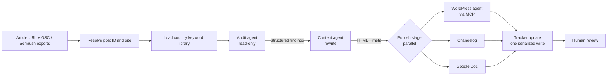

# Architecture

## Design decisions

1. **Separate agents by permission.** The audit agent is read-only. Only the WordPress agent can write to live sites.
2. **Structured hand-offs.** Each stage returns JSON validated against a schema, so the next stage never parses prose. "Before" values (title, headings, word count) are captured at audit time and carried through to the changelog for before/after comparison.
3. **Pipeline, not batch.** `pipeline()` lets each article advance as soon as its previous stage finishes; one slow article does not block the rest.
4. **Serialize shared writes.** Per-article stages run in parallel, but the shared tracker sheet is updated once after the barrier to avoid read-modify-write races.
5. **Deterministic fixes in code.** Anything that must be exactly right every time (FAQ schema block, no `<h1>` in body, no placeholder meta) is enforced by code and lint checks, not left to a prompt.
6. **Right model for the job.** Haiku for summaries and sheet rows; Sonnet where output reaches production.
7. **Credentials stay out of agents.** Site credentials live in the MCP server's environment; agents only see tool names.
